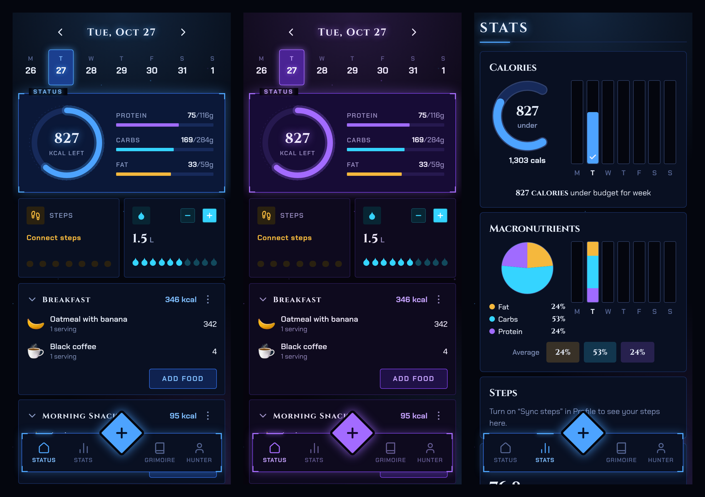

# LozzIt SL

Dark fantasy fork of [Lozzit](https://github.com/gajamokanb-web/Lozzit), the calorie tracker (Expo / React Native, Android first), re-skinned in the spirit of *Solo Leveling*. Same features, same data model: only the UI changed.
First launch walks you through creating a profile; meals, water and profile are stored on the phone.



## Look & feel
- **Two dark themes** (Profile > Appearance): *Monarch* (System-window blue, default), *Shadow* (shadow-monarch violet), and *Auto* (Monarch, Shadow when the phone is in dark mode).
- **Type**: Cinzel (engraved serif) for titles and big numbers, Chakra Petch (angular HUD sans) for everything else.
- **Shapes**: angular panels with glowing borders and corner brackets, a diamond "gate" button in the nav, rune medallions for meals and water, a glowing status ring on the home screen.
- Tabs are renamed Status / Stats / Grimoire (recipes) / Hunter (profile).
- Everything is driven by `src/theme.ts` (palettes, fonts, glow helpers) and `src/ui.tsx` (shared components).
- It installs next to the original: its Android package is `com.lozzit.sl`.

## Get the APK
Every push to `main` triggers the **Android APK** workflow (Actions tab). When it is green, open
**Releases → LozzIt SL APK (latest)** on your phone and install `lozzit_sl.apk`
(allow installs from your browser when Android asks).
The APK is signed with the Expo debug key: fine for testing, not for the Play Store.

## Dev
```
npm install
npm run typecheck
npx expo start
```
Data lives in AsyncStorage on the device (`src/store.tsx`). Steps are not wired yet.
Fonts: Cinzel and Chakra Petch (SIL OFL, via @expo-google-fonts). Icons: Lucide (ISC). Meal photos: Wikimedia Commons, CC BY-SA.

## Data sources
- Foods: Anses, Table de composition nutritionnelle Ciqual 2025 (Licence Ouverte Etalab 2.0), bundled in `assets/ciqual.json` (compact copy via github.com/ar11tehau/food, usual portions from Anses INCA3).
- Packaged products and barcodes: Open Food Facts (ODbL), queried online.
- Steps: Health Connect (Google Fit, Mi Fitness, Samsung Health…), source selectable in Profile.

## Food logos

Food and meal icons in `assets/food` and `assets/meals` come from the user's own screenshots of a Lose It-style icon set (personal use). `src/foodIcons.tsx` suggests an icon from the food name (French keywords).
